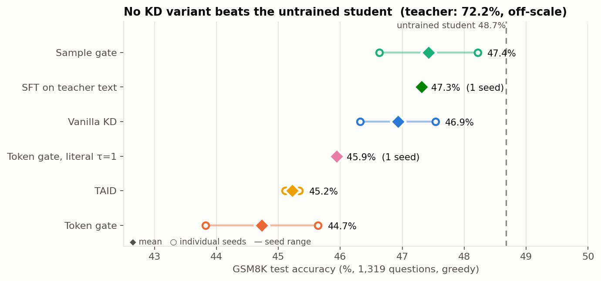
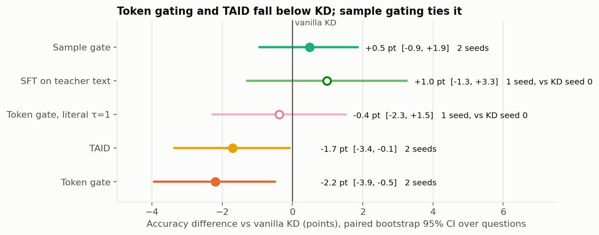
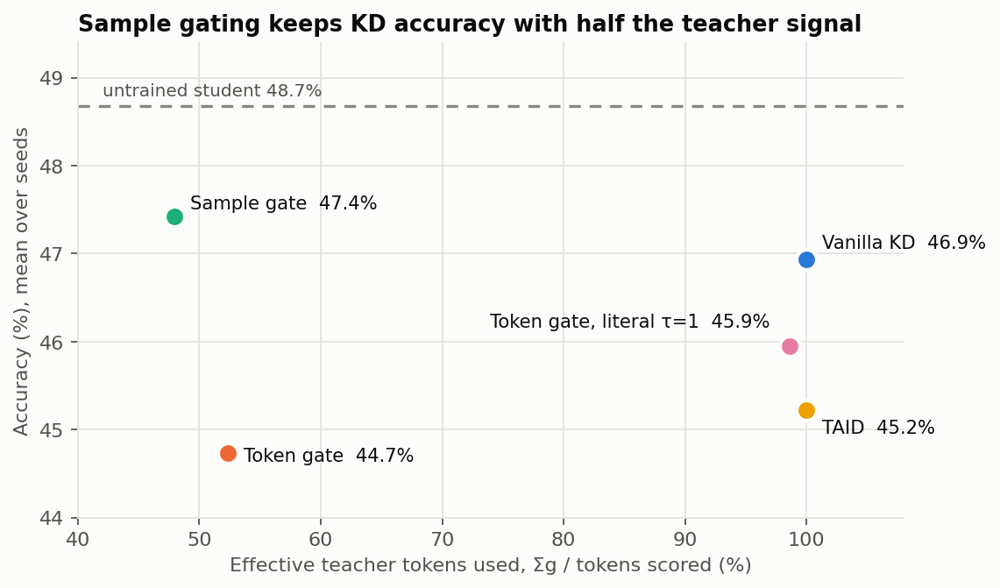
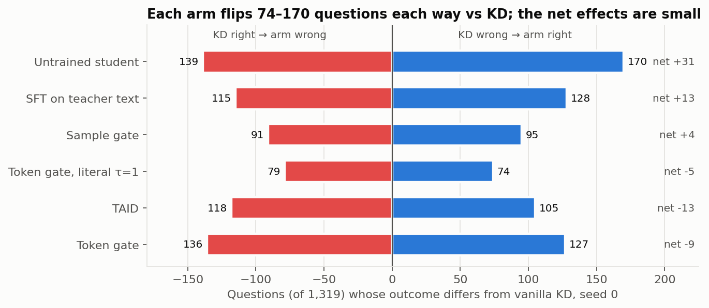
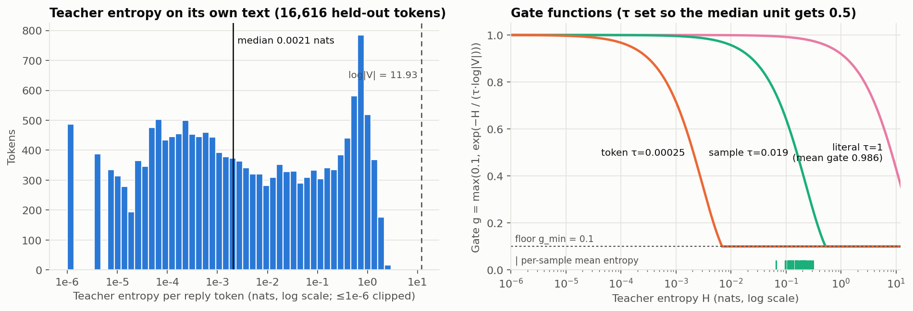
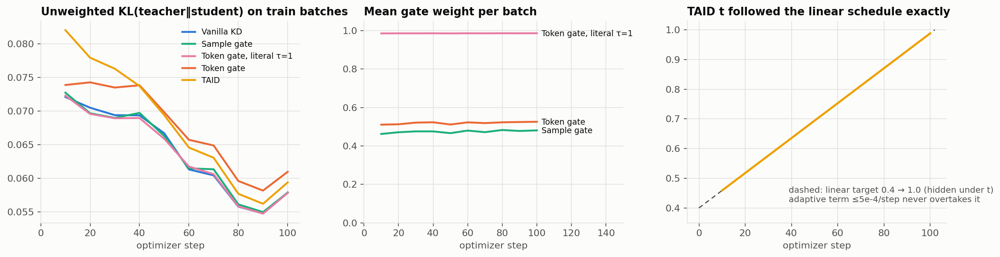
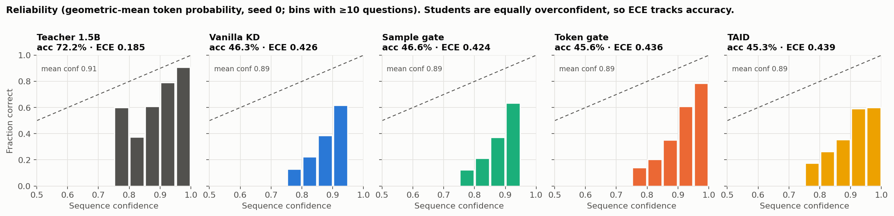
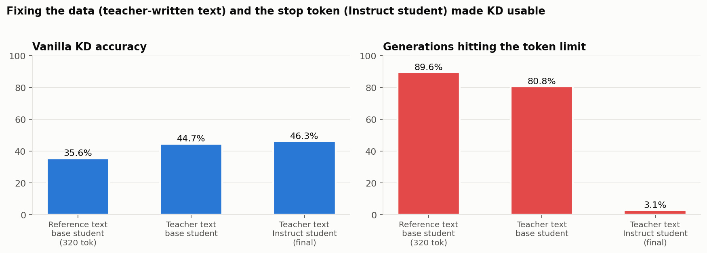

# Reproduce: TAID and GRACE-style token-gated KD on GSM8K

A single-GPU (8 GB laptop) reproduction comparing **ungated KL distillation**, a **GRACE-style
teacher-entropy gate** at token and sample level, and **TAID** (Shing et al., 2025,
[arXiv 2501.16937](https://arxiv.org/abs/2501.16937), [SakanaAI/TAID](https://github.com/SakanaAI/TAID)).
Teacher: **Qwen2.5-1.5B-Instruct**. Student: **Qwen2.5-0.5B-Instruct**. Data: GSM8K.

- Design log, including every failed attempt and why: [DEVLOG.md](DEVLOG.md)
- 12-hour compute check and downscale: [docs/compute-plan.md](docs/compute-plan.md)

## Bottom line

At this scale, none of the gated or TAID variants beats vanilla KD, and nothing beats the
untrained student. The headline results:

- **Sample-level gating ties KD** (+0.5 pt, CI includes 0) using **48% of the effective teacher
  tokens**.
- **Token-level gating hurts** (−2.2 pt over two seeds; the CI excludes 0). Down-weighting the teacher's
  uncertain "pivot" tokens costs accuracy even with a 0.1 floor, as EGRSD warns.
- **TAID is slightly worse than KD** (−1.7 pt), and its adaptive term never engages in 102 steps.
- **No method improved calibration.** All confidence measures move with accuracy; the arms'
  mean confidence is the same.



## What is compared

| Arm | Loss on reply tokens | Gate / schedule |
|---|---|---|
| `kd` | KL(p_T ‖ q_S) | none (ungated baseline) |
| `token_gate` | Σ g_i·KL_i / Σ g_i | **token**: g_i = max(0.1, exp(−H_i / (τ·log\|V\|))), τ = 2.51e-4 |
| `sample_gate` | same | **sample**: one g per sequence from its mean H_i, τ = 0.0190 |
| `token_gate_literal` | same | token, **τ = 1**, i.e. the literal exp(−H/log\|V\|) |
| `taid` | CE(p_t, q_S), p_t = softmax((1−t)·sg(z_S) + t·z_T) | t: 0.4 → 1.0, momentum-adaptive (ported) |
| `sft` | CE on the teacher's solutions | sequence-level KD reference |

H_i is the **teacher's** entropy at reply position i, in fp32 over the 151,665 real vocabulary rows.
τ was fixed **before training** on 58 held-out teacher solutions with one rule for both
granularities: the median unit gets gate 0.5. On its own text the teacher's median entropy is
0.002 nats against log|V| = 11.93, so the **literal formula is nearly a no-op** (mean gate 0.986).
Gated losses are normalized by Σg, so gating changes the token mix, not the learning rate.

**Setup.** KD runs on 1,619 teacher-generated, answer-verified solutions (first 2,800 seeded
GSM8K train prompts) for 1 epoch. The student is trained with LoRA r=64/α=128 on all linear layers,
lr 2e-4 cosine, effective batch 16, max length 768, bf16. All arms see identical data and order.
Evaluation covers all **1,319 GSM8K test** questions, greedy, 512 new tokens.

## Results

Two training seeds for the four core arms (seed changes LoRA init; data is fixed). The CI is a
paired bootstrap over test questions on seed-averaged correctness. It does **not** include
between-seed variance; KD itself moved 1.2 pt between seeds.

| Arm | Acc (seed 0, 1) | Acc mean | ΔAcc vs KD (95% CI) | ECE ans ↓ | ECE seq ↓ | ECE min-tok ↓ | Teacher tokens: scored / effective Σg |
|---|---|---|---|---|---|---|---|
| Teacher 1.5B-Instruct | 0.722 | 0.722 | — | 0.265 | 0.185 | 0.429 | — |
| Student 0.5B-Instruct, untrained | 0.487 | 0.487 | — | 0.494 | 0.410 | 0.213 | — |
| **Vanilla KD (ungated)** | 0.463, 0.475 | **0.469** | baseline | 0.508 | 0.420 | 0.198 | 455,827 / 455,827 (100%) |
| Token-gated KD | 0.456, 0.438 | 0.447 | **−0.022 [−0.039, −0.005]** | 0.533 | 0.446 | 0.175 | 455,827 / 238,627 (52%) |
| Sample-gated KD | 0.466, 0.482 | **0.474** | +0.005 [−0.009, +0.019] | 0.504 | 0.416 | 0.202 | 455,827 / 218,486 (48%) |
| TAID | 0.453, 0.451 | 0.452 | −0.017 [−0.034, −0.001] | 0.521 | 0.440 | 0.178 | 455,827 / 455,827 (100%) |
| Token gate, literal τ=1 (1 seed) | 0.459 | 0.459 | −0.004 [−0.023, +0.015]¹ | 0.514 | 0.431 | 0.188 | 455,827 / 449,447 (99%) |
| SFT on teacher text (1 seed) | 0.473 | 0.473 | +0.010 [−0.013, +0.033]¹ | 0.511 | 0.462 | 0.123 | 0 (768,969 generated) |

¹ Versus seed-0 KD only. Per-seed tables: [results/results.md](results/results.md),
[results/seed1/results.md](results/seed1/results.md). Aggregate: [results/seeds.md](results/seeds.md).





The small net differences hide a lot of churn. Each arm changes the outcome on 74–170 of the 1,319
questions relative to KD, in both directions:



**Confidence measures.** "ECE ans" uses the joint probability of the final-answer tokens. "ECE seq"
uses the geometric-mean token probability of the whole decode. "ECE min-tok" uses the least
confident token. All use 10 equal-width bins.

### Reading the results

1. **Gating granularity matters, and the sign flips.** Sample gating weights whole solutions by
   how confident the teacher was overall. It matched or slightly beat KD in both seeds while
   spending under half the effective teacher signal. Token gating with the same rule removed
   distillation signal from exactly the high-entropy branching tokens, such as which operation
   comes next. It lost in both seeds (−0.7 and −3.7 pt).
2. **The literal GRACE gate is inert on math text.** With τ = 1, `exp(−H/log|V|)` only spans
   0.78–1.0, because a confident teacher's entropy is a tiny fraction of log|V|. Any useful gate
   needs a τ calibrated to the teacher's entropy scale.

   
3. **TAID did not help here.** With 102 optimizer steps, TAID's adaptive increment
   (α·sigmoid(m)·(1−t) ≤ 5e-4) is far below the linear target's 0.006 per step, so `t` simply
   followed the linear 0.4 → 1.0 ramp ([training curves](results/training_curves.png)).
   TAID's gains in the paper come from large capacity gaps and multi-epoch training; here the
   student starts with KL ≈ 0.07 to the teacher, which leaves little to bridge.

   
4. **KD barely moves an already-tuned student.** Every trained arm is 1–4 pt below the untrained
   0.5B-Instruct (48.7%). LoRA on 1.6k solutions for one epoch mostly shifts the student's style
   toward the teacher's; it does not add capability.
5. **Calibration is unchanged.** Mean confidence is the same across KD arms (answer-token ≈ 0.98,
   sequence ≈ 0.89, min-token ≈ 0.27). Each ECE therefore tracks accuracy: ECE_seq ≈ 0.89 − acc,
   ECE_min ≈ acc − 0.27. The lower min-token ECE of token gating and TAID is a side effect of
   lower accuracy, not better calibration. The answer-token measure is degenerate, because the
   final number is copied from the student's own working, so its probability is ≈ 1 whether
   right or wrong ([plot](results/accuracy_vs_ece.png)).

   

### Ablations kept from failed setups (base Qwen2.5-0.5B student)



| Setup | Acc | Truncated | What went wrong |
|---|---|---|---|
| KD on GSM8K **reference** solutions, 320 new tokens | 0.356² | 90% | The teacher's distribution pushes the start of each reply toward its own verbose style. The student never learns how that style continues, so its generations degenerate. |
| KD on **teacher** solutions, base student | 0.447 | 81% | In the base model, the `<|im_end|>` output row is cos ≈ 1.0 with a cluster of untrained rows. LoRA cannot separate them, so the student emits `𬭶` instead of stopping. |

² Re-scored with `\boxed{}` extraction (30.7% under the original `####`-only parser).

## Compute (RTX 4060 Laptop, 8 GB)

| | |
|---|---|
| Peak VRAM | train 5.64 GB (micro 2 × accum 8, gradient checkpointing); eval 3.67 GB |
| Throughput | ~1,400–1,500 tok/s KD including the teacher forward; 7 min per arm |
| GPU time, final pipeline | 3.8 h: 1.1 train, 2.0 eval, 0.7 teacher generation |
| Wall clock | 20:32 → 06:24 (9.9 h), including ~3.5 h waiting for another GPU job |

## Run it

```powershell
pip install torch==2.5.1 --index-url https://download.pytorch.org/whl/cu121
pip install -r requirements.txt
python -m unittest discover -s tests -p "test_*.py" -v
python -m scripts.generate_teacher                  # teacher solutions → outputs/teacher_data
python -m scripts.calibrate_tau --data-file outputs/teacher_data/teacher_calib.jsonl --output outputs/calibration/tau_tgen.json
python -m scripts.run_all --train-size 5000 --micro-batch 2 --grad-accum 8 --wait-for-gpu 6500
python -m scripts.run_all --arms kd token_gate sample_gate taid --extra-arms --skip-reference --seed 1 --train-size 5000 --micro-batch 2 --grad-accum 8 --root outputs/runs_instruct_s1 --report-dir results/seed1
python -m scripts.aggregate_seeds --roots outputs/runs_instruct outputs/runs_instruct_s1
python -m scripts.figures                           # results/figures/*.png
```

`run_all` is resumable: it skips any step whose receipt exists, waits for free VRAM, and retries
an OOM with micro-batch 2 and gradient checkpointing.

## Layout

- `tgkd/gates.py`: stable entropy (`0·log0`-safe), token and sample gates, τ calibration
- `tgkd/losses.py`: per-token KL and CE, TAID loss and `t` schedule (ported from SakanaAI/TAID)
- `tgkd/answers.py`: `####` / `\boxed{}` extraction, answer-token confidence, ECE, Brier
- `tgkd/data.py`: GSM8K formatting and reply masks
- `scripts/`: `generate_teacher`, `calibrate_tau`, `train_kd`, `evaluate`, `run_all`, `report`, `aggregate_seeds`, `figures`
- `results/`: tables, τ calibration and generation receipts, raw held-out teacher entropies
- `results/figures/`: README figures, regenerated by `python -m scripts.figures`

## Deviations from the papers

- LoRA instead of full fine-tuning, with 1,619 examples × 1 epoch. Both are forced by 8 GB and 12 h.
- The student is the Instruct model: the base model cannot emit `<|im_end|>` under LoRA (see ablations).
- KD is off-policy, on the teacher's own answer-verified greedy solutions (as in TAID's
  UltraChat setup). It is not on-policy, as in GKD.
- TAID's `t` updates once per optimizer step on that step's mean loss, not per Lightning step.
- GRACE (arXiv 2601.22709) targets VLM quantization. Only its confidence-gating idea is
  reimplemented here, for text KD.
- Two seeds for the core arms and one for the rest, so small differences remain uncertain.
